# IntentLoop · Meta AI for Instagram — **outcome** when your daily limit hits

## Impact · **Build for Your World**

**Meta Global AI Developer Hackathon 2026** · Indie track · Theme: **Build for Your World**

Instagram already helps billions of people manage **time** (Time spent, 15 / 30 / 45 minute limits). It does not yet answer, at the moment you pause: **what was this visit for, and did I do it?** That gap shows up in ordinary life — on a **call with the phone on your lap**, “just one DM,” then Reels; creators asking **did I post?**; anyone ending a scroll without closure.

**IntentLoop** is a **session layer** we built **during the hackathon** inside a faithful **mock Instagram**: same **feed first** open, same **daily limit** sheet — plus **See visit summary** (outcome, drift, **time + where**, one optional next step). No new app. No lecture on launch. Summaries stay on **your device** in **Your activity**.

| Who benefits | Why it matters |
|--------------|----------------|
| **Daily-limit users** | Turn “time’s up” into **honest closure**, not guilt |
| **DM / Create openers** | See when Reels **drifted** the visit; nudge back to the job |
| **Companion-scroll** | Neutral summary when there was no single task — real **Build for Your World** behavior |
| **Creators** | “Posted this visit” reflected in the summary |
| **Meta / Instagram** | Uses **trust UI people already have**; makes **Meta AI** useful for structured life moments, not another chat box |

**Could people use this?** If Meta shipped one row on the existing limit sheet, yes — same controls, clearer **outcome**. This repo is a **working prototype** ([live demo](https://meta-ai-hackathon-intent-loop.vercel.app/)), not production Instagram.

**Reading this repo for judging (Stage 2 rubric):**

| Category | Where to look in this README |
|----------|------------------------------|
| **Impact (30%)** | This section · [If Meta shipped this](#if-meta-shipped-this) · [A day you recognize](#a-day-you-recognize) |
| **Use of Meta AI (25%)** | [Meta AI tools — where and why](#meta-ai-tools--where-and-why) · [Architecture](#architecture) |
| **Technical depth (20%)** | [What we built](#what-we-built) · [Architecture](#architecture) · [Trust, consent, and data](#trust-consent-and-data) · rate limit in [Run locally](#run-locally) |
| **Demo (25%)** | [Live demo](https://meta-ai-hackathon-intent-loop.vercel.app/) · [Demo videos (for judges)](#demo-videos-for-judges) · [Judge / demo path](#run-locally) |

---

## Instagram counts the minutes. IntentLoop names the outcome.

*Time limits tell you **how long**. A **visit summary** tells you **what the visit was for** — and whether it matched why you opened the app.*

Powered by **Meta Model API** — Muse Spark, Voice Transcribe, SAM 3.1, Muse Image — on the routes in the table below.

**Live demo:** [https://meta-ai-hackathon-intent-loop.vercel.app/](https://meta-ai-hackathon-intent-loop.vercel.app/)  
**Repository:** [github.com/Akshay1018/meta_ai_hackathon_intentLoop](https://github.com/Akshay1018/meta_ai_hackathon_intentLoop)  
**Hackathon:** [Meta Global AI Developer Hackathon 2026](https://cerebralvalley.ai/e/meta-ai-developer-hackathon) · Indie · **Build for Your World** · [Meta Model API](https://dev.meta.ai/docs/overview)

## Demo videos (for judges)

| | Link |
|--|------|
| **Primary — hackathon submission demo (~3 min)** | [YouTube — narrated walkthrough](https://www.youtube.com/watch?v=UAw3k_FNUm8) |
| **Supplementary — silent screen recording (~2.5 min)** | [YouTube — product only, no audio / no webcam](https://www.youtube.com/watch?v=hzwBpWJo5Xw) |

**Use the primary video for judging.** It matches the hackathon submission: English narration, presenter on camera, and walkthrough of features, code context, and live Meta Model API behavior on Vercel.

**Use the supplementary video** if you prefer a quiet, full UI pass: screen capture of the entire IntentLoop flow on the live app (visit → daily limit → **See visit summary** → Reels record → Surroundings / SAM), with no voiceover and no picture-in-picture.

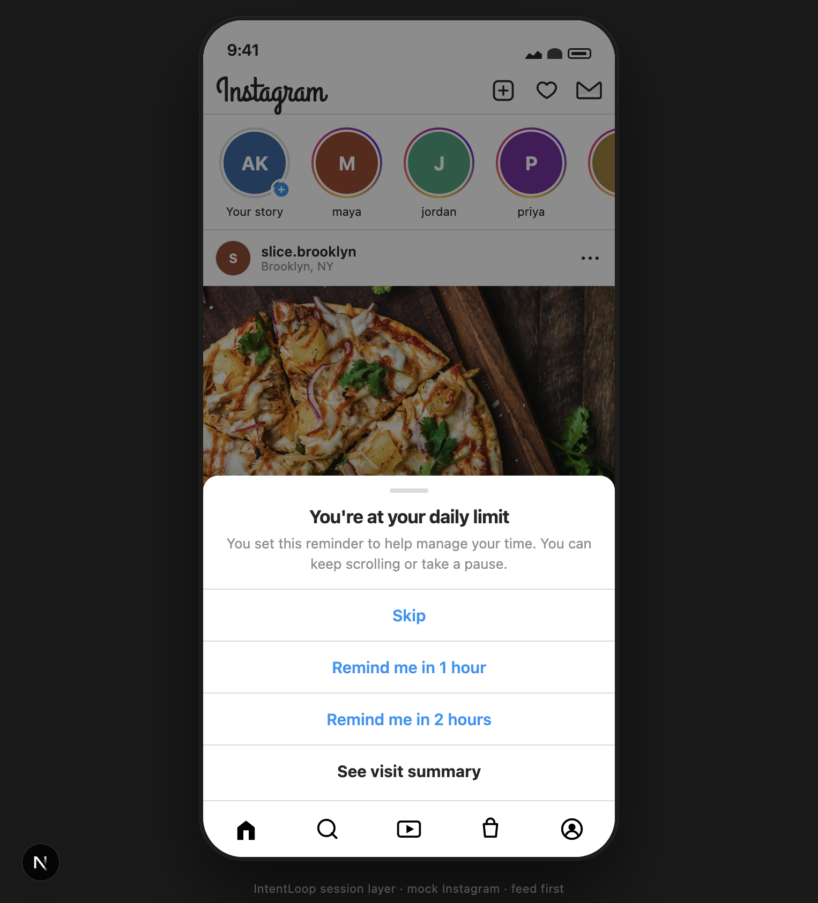

***You’re at your daily limit** — same sheet on Feed or Reels, with **See visit summary** as the IntentLoop door.*

---

## Meta AI tools — where and why

We use **specialized models for specialized jobs** — structured JSON and media routes, not one chat box.

| Feature / use case | Meta model (default ID) | Route | Where in the app | Why this model |
|--------------------|-------------------------|-------|------------------|----------------|
| Silent intent line | **Muse Spark 1.3** `muse-spark-1.3` | `POST /api/intent` | DMs, Create header chip | Strict **JSON** IntentCard; cached once per surface per visit |
| Visit summary | **Muse Spark 1.3** | `POST /api/exit` | Limit sheet → **See visit summary** | ExitBrief schema: drift, happened, next_action |
| Screenshot vs intent | **Muse Spark 1.3** (vision) | `POST /api/vision` | Brief → **Match a screenshot** | Compares **your** photo to why you opened |
| Voice recap | **Muse Voice Transcribe** `muse-voice-transcribe-1.0` | `POST /api/transcribe` | Brief → **Say what you still wanted** | Short WAV → text on device flow |
| Voice → next step | **Muse Spark 1.3** | `POST /api/voice-follow-up` | After transcribe | Routes to Search / Reels in mock UI |
| Recording surroundings | **SAM 3.1** `sam-3.1` + **Spark** (same request) | `POST /api/segment` | Reels → camera → alerts | SAM for segmentation signal; Spark reads frame for plain nudge |
| Visit memento | **Muse Image** `muse-image-1.0` | `POST /api/card` | Brief → **Create visit card** | Visual close users can keep locally |

**Not in the in-app loop:** Muse Code / Wonder (how we authored the repo). **Deferred:** Baseten Spark Open fallback, PWA.

API base: `https://api.meta.ai/v1` — see [Meta Model API](https://dev.meta.ai/docs/overview). Configure via `.env.local` ([`.env.example`](.env.example)).

The table above is the **model map**; [Architecture](#architecture) below is **how those routes, UI, and client state connect** in one visit.

---

## Architecture

IntentLoop is a **Next.js App Router** app: a **mock Instagram shell** (`app/(ig)/`, `components/ig/`) wrapped by a **client session layer** (`components/intentloop/`). AI never runs on idle Home scroll — it runs at **intent surfaces**, **daily limit → summary**, and **opt-in** extras (voice, vision, card, Reels surroundings). All Meta calls go **server-side** (`app/api/*` → `lib/meta*.ts`); the browser only sends visit context and user-chosen media.

### System overview

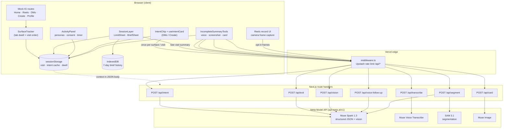

`SessionLayer` and `SurfaceTracker` mount from `components/ig/IgLayoutChrome.tsx` on every IG route so limit sheets and tracking stay consistent across tabs.

### Visit lifecycle (one demo session)

| Phase | What runs | Where state lives |
|-------|-----------|-------------------|
| **1. Arm session** | User turns IntentLoop on and **Start new visit (demo)** | `lib/session.ts` — timer mode (45s demo vs minutes), `startedAt` |
| **2. Browse (no AI on Home)** | `SurfaceTracker` records tab enters + seconds per surface | `lib/visit-tracker.ts`, `lib/visit-dwell.ts` → sessionStorage |
| **3. Intent (first open per surface)** | Opening **DMs** or **Create** triggers `useIntentCard` → `POST /api/intent` | `lib/intent-cache.ts` caches **IntentCard** per surface for this visit |
| **4. Limit** | `useLimitTimer` hits threshold → **LimitSheet** (Skip / Remind / **See visit summary**) | Same session clock; no Meta call yet |
| **5. Exit brief** | **See visit summary** → `useExitBrief` bundles intent + dwell + persona + posted flag → `POST /api/exit` | Response **ExitBrief** → `BriefSheet`; append to `lib/brief-history.ts` + `lib/brief-idb.ts` |
| **6. Optional extras** | On summary sheet: screenshot / voice / visit card (each gated by `lib/consent.ts`) | Separate API routes; voice chain: transcribe → voice-follow-up |
| **7. Reels surroundings (parallel path)** | **Reels → Record** with alerts on: periodic frame → `POST /api/segment` (`context: "recording"`) | `lib/capture-video-frame.ts`, `lib/surroundings-notify.ts`, UI nudge + optional line on summary |

Primary intent for exit is chosen with `lib/intent-primary.ts` from the surface visit order (e.g. DMs before Reels wins for “what you came to do”).

### API routes → Meta models → UI

| Route | Trigger (UI) | Server module | Meta model(s) | Structured output |
|-------|----------------|---------------|---------------|-------------------|
| `POST /api/intent` | DMs / Create mount | `lib/intent-from-spark.ts` | **Muse Spark 1.3** | `IntentCard` JSON schema (`lib/schemas.ts`) |
| `POST /api/exit` | **See visit summary** | `lib/exit-from-spark.ts` | **Muse Spark 1.3** | `ExitBrief` (drift, happened, next_action, …) |
| `POST /api/vision` | **Match a screenshot** on brief | `lib/meta-vision.ts` | **Spark vision** | vs-intent copy + mock Search prefill (`lib/vision-action.ts`) |
| `POST /api/transcribe` | **Say what you still wanted** | `lib/meta-voice.ts` | **Muse Voice Transcribe** | transcript text |
| `POST /api/voice-follow-up` | after transcribe | `lib/voice-follow-up.ts` | **Muse Spark 1.3** | route hint (Search / Reels / DMs) |
| `POST /api/segment` | Reels record surroundings / walk photo | `lib/meta-segment.ts`, `lib/meta-recording-surroundings.ts` | **SAM 3.1** + **Spark** | masks + merged **nudge** line for on-screen card |
| `POST /api/card` | **Create visit card** | `lib/meta-image.ts` | **Muse Image** | image URL; text composited client-side |

Every JSON response can include `meta.model` (see `lib/meta.ts`) so judges can verify live Spark/SAM in Network tab. Fixtures activate when `INTENTLOOP_FIXTURE=1` or no `MODEL_API_KEY` — **public Vercel demo uses real keys**, not fixtures.

### Reels surroundings pipeline (SAM + Spark)

This path is independent of the daily limit timer but shares the same visit record:

1. **Consent** — toggles in **Your activity** (`useConsentSettings`, `ConsentBanner`).
2. **Capture** — `<video>` preview on `app/(ig)/reels/record`; `lib/capture-video-frame.ts` samples JPEG frames while alerts are on.
3. **Segment** — `POST /api/segment` with `context: "recording"` sends base64 frame to **SAM 3.1** (`lib/meta-segment.ts`).
4. **Narrate** — Spark structured analysis (`analyzeRecordingSurroundings`) + `mergeSamAndVisionNudge` produces one calm **nudge** and alert level.
5. **Notify** — `lib/surroundings-notify.ts` dedupes; UI shows scanning → **SURROUNDINGS** sheet; optional note on exit brief via `lib/visit-surroundings.ts`.

No feed upload; scanning stops when the user leaves record or turns alerts off.

### Personas and copy

`lib/persona-catalog.ts` + `lib/persona-engine.ts` adjust Spark prompts and UI tone (10 personas in **Your activity**). Personas change **wording and intent examples**, not hidden surveillance — no call/location APIs.

### Production hardening (public demo)

| Layer | Role |
|-------|------|
| `middleware.ts` | Per-IP rate limits on `/api/*` via **Upstash Redis** (`lib/rate-limit.ts`) |
| `lib/api-client.ts` | Client 429 handling + user-facing retry copy |
| `MODEL_API_KEY` | Server env only on Vercel — never exposed to the browser |

### Repo map (where to read code)

| Concern | Paths |
|---------|--------|
| IG shell + nav | `app/(ig)/`, `components/ig/` |
| Session UX | `components/intentloop/SessionLayer.tsx`, `LimitSheet.tsx`, `BriefSheet.tsx`, `ActivityPanel.tsx` |
| Schemas / fixtures | `lib/schemas.ts` |
| Meta client | `lib/meta.ts`, `lib/meta-env.ts` |
| Tests | `lib/*.test.ts`, `npm test` |

**End-to-end UI (silent):** [YouTube screen demo ~2.5 min](https://www.youtube.com/watch?v=hzwBpWJo5Xw)

---

## Table of contents

- [Impact · Build for Your World](#impact--build-for-your-world)
- [Demo videos (for judges)](#demo-videos-for-judges)
- [Meta AI tools — where and why](#meta-ai-tools--where-and-why)
- [Architecture](#architecture)
- [A day you recognize](#a-day-you-recognize)
- [Why IntentLoop](#why-intentloop)
- [The gap Instagram leaves today](#the-gap-instagram-leaves-today)
- [If Meta shipped this](#if-meta-shipped-this)
- [How IntentLoop helps](#how-intentloop-helps)
- [Who it is for (personas)](#who-it-is-for-personas)
- [What we built](#what-we-built)
- [Real situations we designed for](#real-situations-we-designed-for)
- [Trust, consent, and data](#trust-consent-and-data)
- [Screenshots by feature](#screenshots-by-feature)
- [Run locally](#run-locally)
- [Tests and credits](#tests-and-credits)
- [License](#license)

---

## A day you recognize

You’re on a **video call** or in a **group chat on speaker**. Instagram is open on your lap. You tell yourself you’ll check **one DM** — then Stories, then Reels. The call ends and you realize you never sent that reply.

Today, when your **daily limit** pops up, you can **Skip** and keep scrolling. You still might not know:

- **Why did I open Instagram this time?**
- **Did I do that one thing?**
- **Where did the visit go** — Messages, Feed, or Reels?

IntentLoop adds **See visit summary** on that **same bottom sheet**. One tap → **visit summary**: a plain **outcome** line, **drift**, **time + where**, and an optional **next step** (for example, “Open DMs”). No lecture. **Skip** still works.

We do **not** listen to your call or detect that you’re on speaker. We use the **tabs you open** and **time on each surface** — the same kind of signals you’d expect from **Time spent** — then close the loop when **your limit** hits.

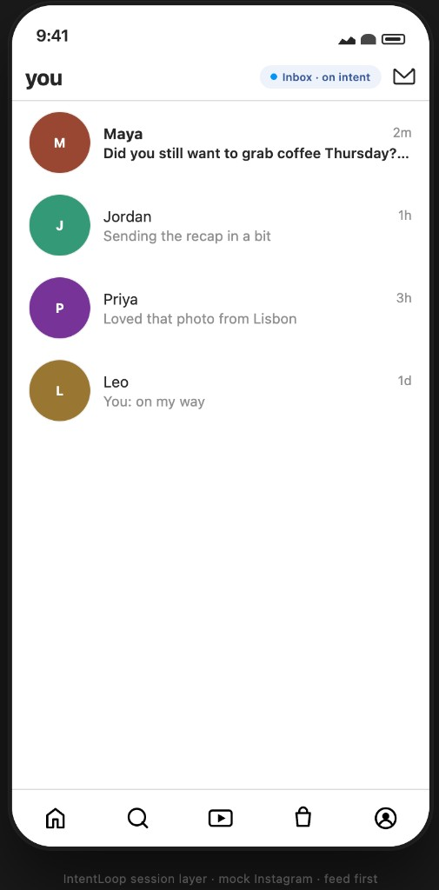

*You opened for Messages — IntentLoop keeps a silent **intent** line while you browse.*

---

## Why IntentLoop

People open Instagram for a **job**: reply to a DM, post a photo, check one story, unwind for five minutes. The app is excellent at keeping you engaged. Meta already gives **Time spent** and **daily limits** (15, 30, 45 minutes, and custom) — that answers **how long** you stayed.

It does not, by itself, answer:

- **What was this visit for?**
- **Did I do the thing I opened for?**
- **Where did the minutes go** (Feed vs Reels vs Messages)?
- **Optional:** Is there something in my **environment** worth a calm nudge while I’m **recording** (with my consent)?

**Objective:** Extend the limit moment people already trust with one **honest visit summary**, stored in **Profile → Your activity**, powered by **structured Meta AI** — not a generic chatbot on launch.

**Psychology (plain language):** Autopilot scrolling — especially when the phone is out during a call or with friends — feels fine in the moment. Closure matters: a **neutral** line about the visit beats shame or a raw minute count.

---

## The gap Instagram leaves today

| What exists today (real Instagram) | What is missing for “outcome” |
|-----------------------------------|-----------------------------|
| Daily time reminders / limits | A structured **summary of the visit** tied to that limit |
| Time spent totals | **Which surfaces** absorbed the visit (Feed, Reels, DMs, …) in plain language |
| Skip / Remind later on the banner | Optional **next step** (“Open DMs”, “Close — post is done”) |
| — | Optional **evidence** you choose (screenshot, voice) compared to why you opened |
| — | In our **demo only**: Reels record + **surroundings check** with consent |

IntentLoop **does not replace** Meta’s controls. In this repo it **mocks** the shell and adds the **outcome layer** judges can click through.

---

## If Meta shipped this

| For people | What would feel different |
|------------|---------------------------|
| **Daily limit users** | Same banner grammar; optional **visit summary** instead of only “time’s up” |
| **DMs / Create openers** | Quiet **intent** line; summary says if Reels **drifted** the visit |
| **Companion-scroll** | Neutral closure after a fuzzy visit — not guilt, not more minutes |
| **Creators** | “Did I post?” answered in the **summary** when they shared |
| **Privacy-minded users** | Summaries on **device**; extras (photo, voice, camera) **opt-in** |

Built **during the hackathon (Oct 26 – Nov 4, 2026)** as a **public prototype**, not a promise of a Meta roadmap.

---

## How IntentLoop helps

```text
Open mock IG (feed first)
  → browse DMs / Reels / Create / Profile (local tab + dwell tracking)
  → silent IntentCard on DMs & Create when needed (Spark, cached per visit)
  → your limit sheet (Skip · Remind · See visit summary)
  → Visit summary: drift, one honest paragraph, time-on-tabs
  → optional: screenshot · voice · visit card · recording surroundings note
  → history in Your activity (Today + 7 days on device)
```

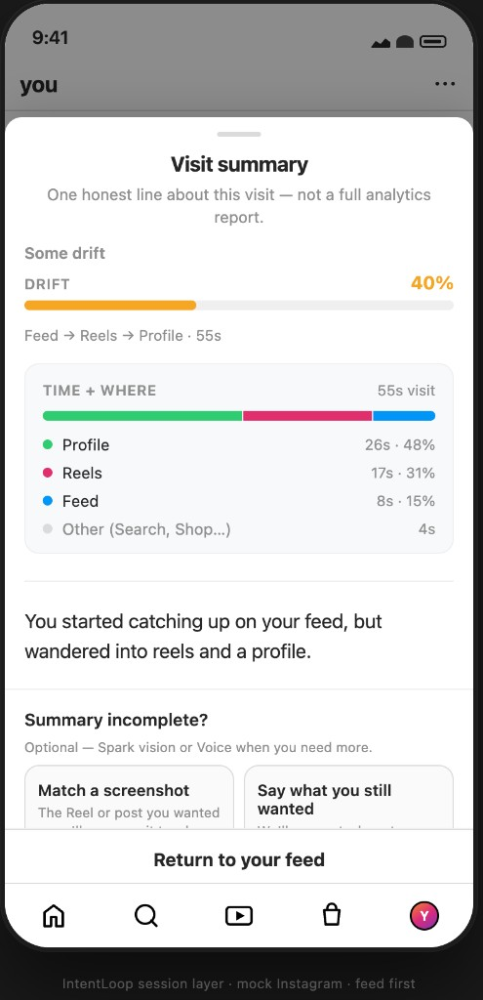

*Visit summary: drift, time + where, one plain-language line.*

---

## Who it is for (personas)

In **Profile → Your activity** you can pick a **persona** to tune demo copy and intent lines. Personas describe **real situations**; the app does **not** spy on calls, location, or other apps.

| Persona | Situation | What IntentLoop adds in this repo |
|---------|-----------|-----------------------------------|
| **Everyday scroller** | “Just five minutes” | Summary when limit hits; Skip always works |
| **Companion-scroll** | Phone out during a **call or with friends**, easy drift | Same limit UX; neutral summary — **no call detection** |
| **DMs-first** | Opened Messages to reply | **Inbox · on intent** chip; summary nudges back to DMs if Reels won |
| **Creator / poster** | Came to share a post | Tracks **posted this visit**; summary leads with the win |
| **Reels binger** | “A few clips” | High drift vs other goals; path line shows Reels time |
| **Profile checker** | Wants pattern over days | **Today** + **Last 7 days** on device |
| **Marketer / influencer / parent / teen (16+)** | Work or bounded personal use | Outcome + tone rules (no “addiction” language) |

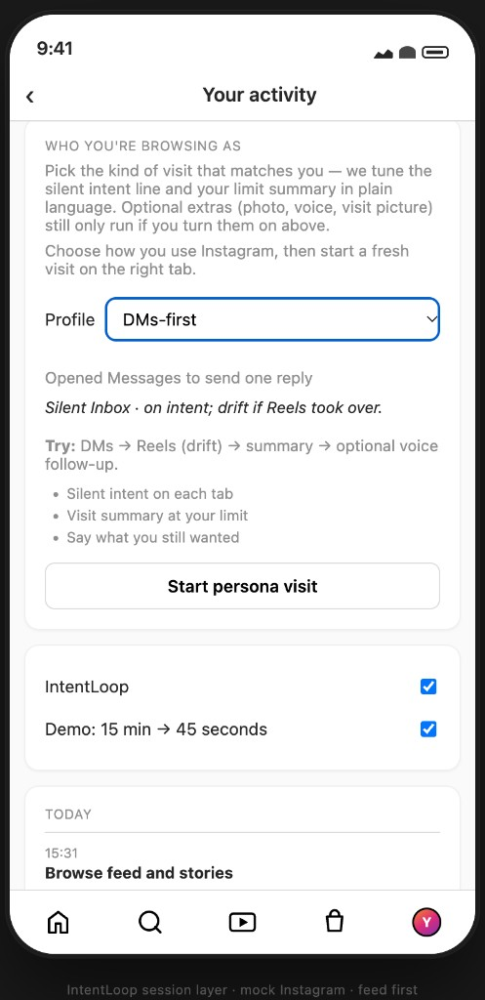

---

## What we built

| Area | Shipped in this repo |
|------|----------------------|
| Mock Instagram | Home, Search, Reels, Shop, Profile, DMs, Create |
| Session layer | Limit timer (45s demo or minutes), limit sheet, visit summary sheet |
| Intent | Spark **IntentCard** on **DMs & Create** (session cache) |
| Exit | Spark **ExitBrief** on **See visit summary** |
| Time + where | Dwell by tab in summary and activity (refresh on demand) |
| History | Today list + IndexedDB **7-day** summaries |
| Personas | 10 personas + **Start persona visit** |
| Brief extras | Screenshot match, voice note, Muse Image visit card (each behind consent) |
| Reels record mock | Mac camera, auto/manual **surroundings** (SAM + Spark), Reels-only alert toggle |
| Search | Prefill `?q=` from vision / voice follow-up (mock results UI) |

Built **during the hackathon window (Oct 26 – Nov 4, 2026)**. All product code in this repository is event work. See [Architecture](#architecture) for how these pieces connect.

---

## Real situations we designed for

### On a call, scrolling with no clear outcome

**Your day:** Speakerphone or group call; Instagram open; you drift through Feed and Reels.  
**IntentLoop:** When **your daily limit** hits, tap **See visit summary**. You get **why the visit looked like** (for example, “You opened for messages but Reels showed up”) and **time + where** — so you know if you still owe yourself that DM. Choose **Companion-scroll** in **Your activity** to tune demo copy for this story.

### Companion-scroll / no single objective

Tabs blur together; there was no one “job.” The **visit summary** still gives a **neutral outcome line** and drift — closure without shame. **No call detection**; no extra sensors.

### DMs intent, Reels wins


Spark sets a silent goal; dwell + exit summary describe whether Messages or Reels dominated.

### Recording a reel — surroundings (demo)

With **consent**, the Reels **record** mock turns on your **Mac camera**. **Surroundings alerts** (toggle on that screen) run SAM + Spark on frames; you can get a nudge if another phone appears in view. Nothing is posted to the feed.

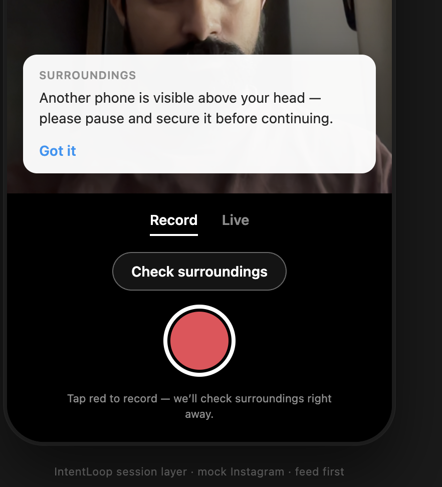

Recording surroundings can also appear under **Recording surroundings** on the visit summary when IntentLoop is on.

### “I meant to save that post”

On the summary sheet, optionally **match a screenshot** (Spark vision) or **say what you still wanted** (Voice + Spark routing).

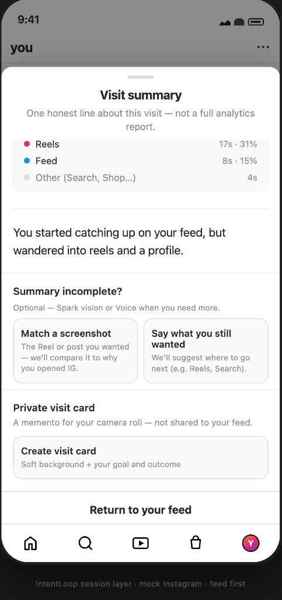

### Private visit card

Optional **Muse Image** background + on-device composited card — memento only, not shared to feed.

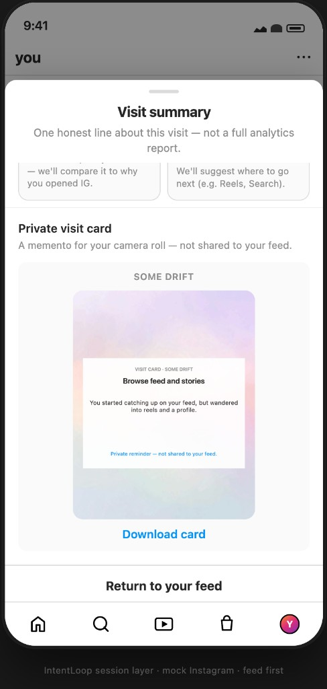

---

## Trust, consent, and data

- Summaries, dwell, and history stay **on this device** (sessionStorage / IndexedDB).
- We do **not** ask for your real Instagram password or read real DMs.
- **Photo, voice, surroundings, visit card** run only when you enable them in **Your activity** and trigger them in flow.

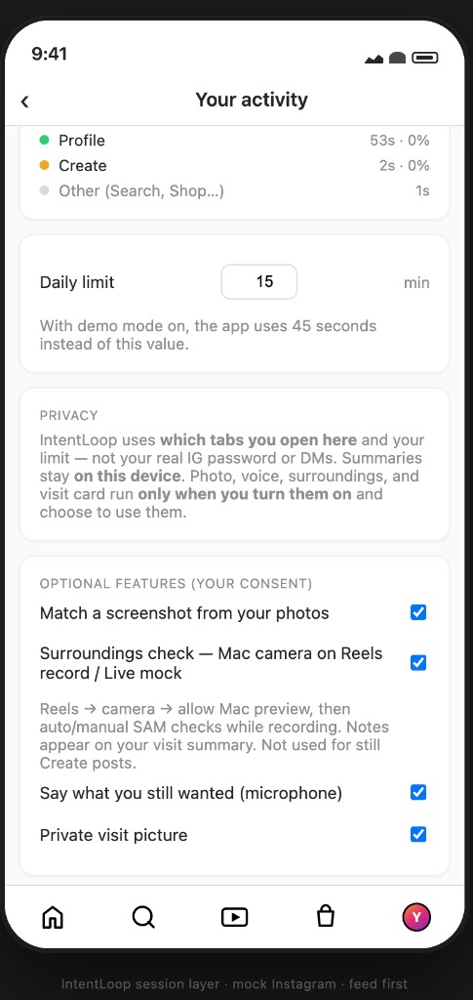

**API usage:** No Meta polling while idle on Home. Intent calls happen when you open **DMs/Create** (first time per visit, then cache). Exit runs when you tap **See visit summary**. Reels surroundings can repeat while the **record** preview is active and alerts are on — leave that page or turn alerts off to stop.

---

## Screenshots by feature

| Topic | Image |
|-------|--------|
| Feed first (no overlay on open) | 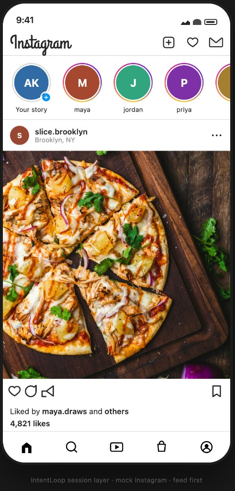 |
| Daily limit on Reels + **See visit summary** |  |
| Reels tab | 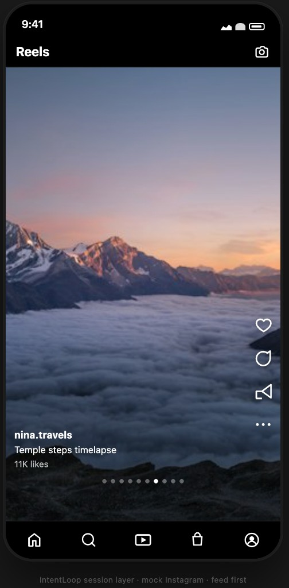 |
| Profile → Your activity | 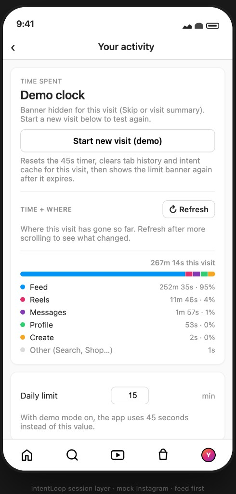 |
| Today history | 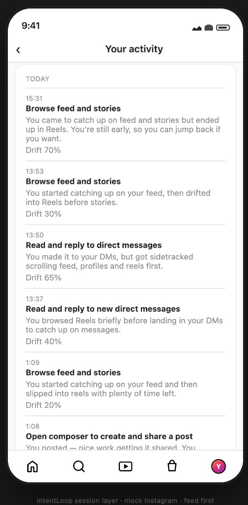 |
| Last 7 days | 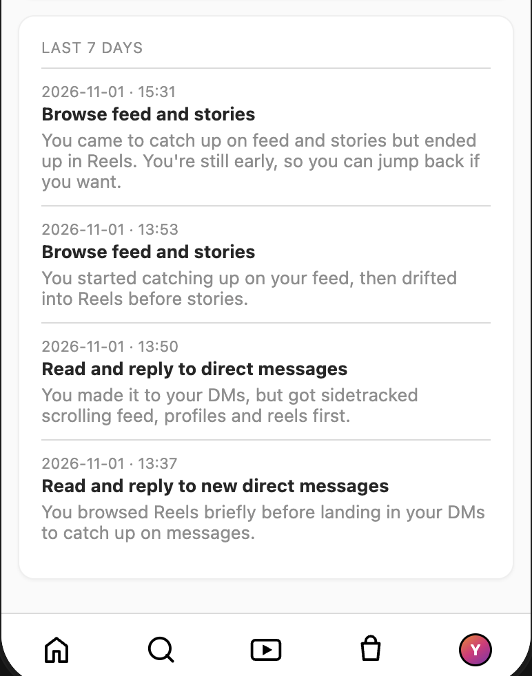 |
| Profile grid | 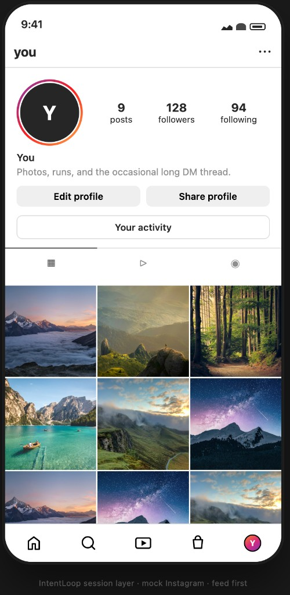 |
| Reels record (before camera) | 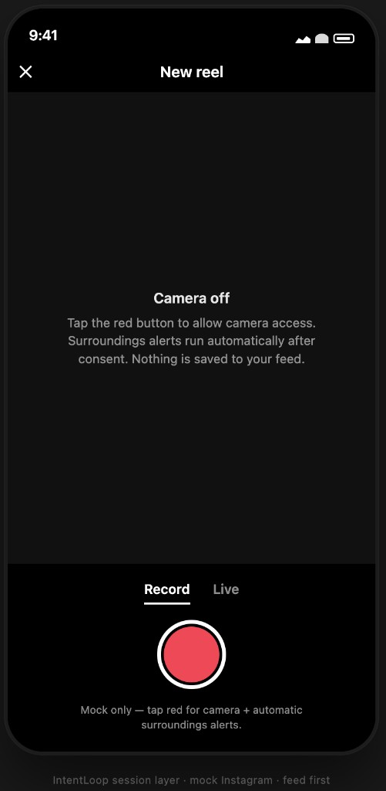 |

---

## Run locally

**Requirements:** Node 20+, npm, `MODEL_API_KEY` in `.env.local` for live Meta (optional fixtures for UI-only).

```bash
git clone https://github.com/Akshay1018/meta_ai_hackathon_intentLoop.git
cd meta_ai_hackathon_intentLoop
npm install
cp .env.example .env.local   # add MODEL_API_KEY
npm run dev:clean
```

Open [http://localhost:3000](http://localhost:3000).

**Judge / demo path (45s):**

1. **Profile → Your activity** → IntentLoop **on** → **Start new visit (demo)**
2. **DMs → Reels → Create** (optional Share)
3. Wait for limit sheet (~45s in demo mode)
4. **See visit summary**
5. Optional: Reels → camera → surroundings; persona picker; check **Today** / **7 days**

If CSS or chunks break: stop port 3000, run `npm run dev:clean`, hard-refresh.  
Route smoke (server up): `npm run smoke:routes`

**Public demo (Vercel):** set `UPSTASH_REDIS_REST_URL` and `UPSTASH_REDIS_REST_TOKEN` so `/api/`* is rate-limited per IP (~150 AI calls/hour — enough for several full judge runs). Users see a plain **Try again** message with retry timing; optional `RATE_LIMIT_BYPASS_SECRET` for submission notes only.

**UI without spending credits:**

```bash
INTENTLOOP_FIXTURE=1 NEXT_PUBLIC_INTENTLOOP_FIXTURE=1 npm run dev:clean
```

---

## Tests and credits

```bash
npm test                    # unit tests — no Meta billing
npm run test:summary-flow   # local API smoke (fixtures if no key)
npm run test:rate-limit     # probe live demo rate limit (fixture, no Meta). Add -- --stress to force 429
npm run test:personas       # persona fixtures
npm run test:meta-live      # light live Meta smoke — uses key
```

Do not run live Meta scripts in a loop.

---

## License

MIT — submission uses a **public** repository. Never commit `.env.local` or API keys.
